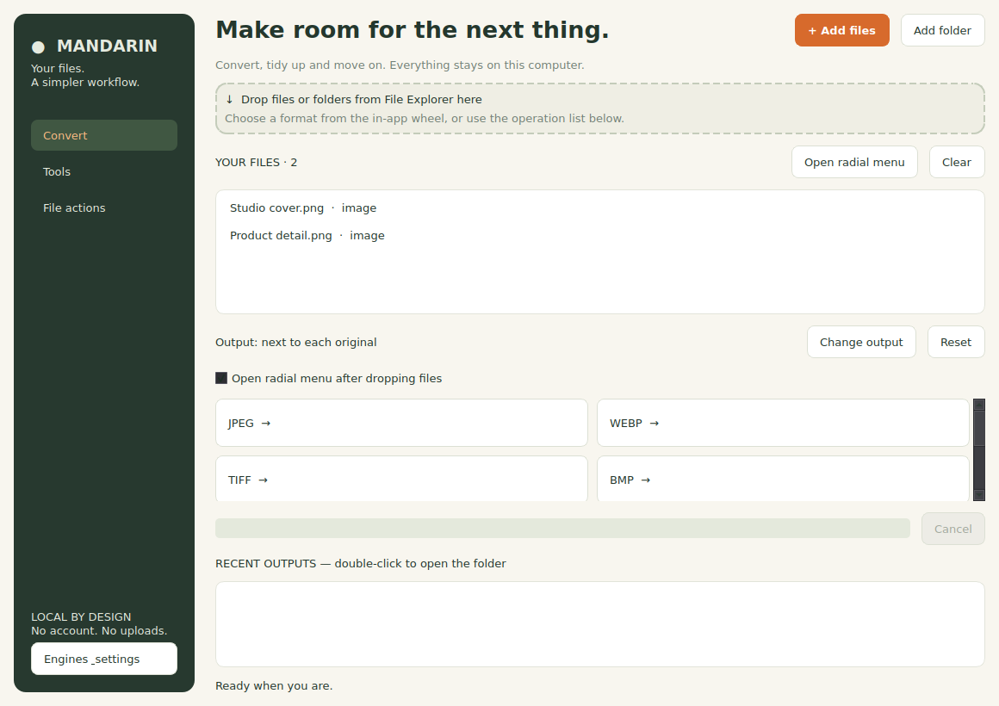

# Mandarin

Local file conversion with a radial menu. Keep files on your own computer,
choose a format and save a new output without overwriting the original.

**v0.1.0 release candidate, unpublished.** Linux Mint GTK/X11 is tested.
The Windows 11 x64 frontend and build pipeline are implemented; native Windows
execution/build and Explorer acceptance are **NOT TESTED**. There is no verified
Windows download yet. See [publication/build readiness](docs/PUBLICATION.md) and [test evidence](docs/TEST_RESULTS.md).



## Features

- Images, audio/video, office documents, PDFs, subtitles and ZIP/TAR operations.
- Batch conversion, destination selection, collision-safe names, cancellation
  and partial batch results; originals stay intact.
- Linux: native GTK window, file-manager drops and X11 modifier-triggered wheel.
- Windows target: Qt window, file/folder dialogs, in-app radial menu after a drop,
  operation options, progress and completed-output history.
- Local processing, no sign-in, upload service or telemetry.

| Integration | Linux Mint | Windows 11 x64 target |
|---|---|---|
| Default GUI | GTK3 | PySide6 / Qt6 |
| Drop onto window | GTK native file URIs | Qt native local-file drops (Explorer acceptance pending) |
| Wheel | X11 desktop; window fallback on Wayland | In-app after drop/selection |
| Desktop modifier / tray | Existing X11 behavior | Not implemented |
| File actions | Existing Linux actions | Copy paths, open file/folder |
| Runtime | System Python + GTK | Python included in future portable ZIP |

## Install and run on Linux Mint

Install system dependencies, then launch from the extracted source directory:

```bash
sudo apt install python3-gi python3-gi-cairo gir1.2-gtk-3.0 python3-pil python3-pypdf ffmpeg libreoffice poppler-utils
chmod +x launch.sh
./launch.sh
```

Optional engines can be omitted; unavailable conversions are disabled. Run
`python3 install.py` for a private per-user application/desktop entry. It refuses
to overwrite an existing install; the development workspace does not silently
upgrade a previous copy. The launcher prefers an existing private `vendor/`
directory but public source contains no bundled vendor binaries.

On X11, drag a file and hold **Shift** for Convert, **Alt** for Tools, or **Ctrl**
for Actions. Escape cancels the wheel. On Wayland use the main drop zone;
Wayland desktop-wide wheel is unavailable and this fallback was not tested in
this development session.

## Windows target

Build on Windows using [BUILDING.md](docs/BUILDING.md), or run the manual Windows
Actions workflow after an approved push. A successful build creates
`Mandarin-Windows-x64.zip`; extract all files and open `Mandarin/Mandarin.exe`.
The workflow verifies PE x64, tests the bundled runtime, extracts the ZIP and
launches it with the build Python removed from PATH. These Windows checks have
**not run yet**; local packaging verification used Linux only.

After a successful approved run, open **Actions → Build Windows portable
candidate → successful run → Artifacts → Mandarin-Windows-x64-candidate**.
Download and unpack the Actions artifact, then extract the inner portable ZIP.
The artifact is a development candidate, not a published release. See
[download/checksum instructions](docs/PUBLICATION.md#download-the-windows-artifact).

Python is bundled. External conversion engines are optional, detected from PATH
or configured in **Engines & settings**. See [Windows setup and acceptance
checklist](docs/WINDOWS.md). No registry edits or system-wide Explorer hooks.

Developers can launch the Windows frontend from source on either OS with Python
3.12 and `pip install -r requirements-windows.txt`, then
`python -m mandarin --frontend qt`. This source option requires Python.

## Supported outputs

| Input | Outputs / tools | Required engine |
|---|---|---|
| Images | PNG, JPEG, WebP, TIFF, BMP, ICO, GIF, PDF; resize/rotate/crop/grayscale/compress/strip metadata | Pillow; installed writers only |
| Audio | MP3, WAV, FLAC, OGG, M4A, Opus, AIFF; trim/normalize | FFmpeg; required encoders |
| Video | MP4, WebM, MOV, MKV, GIF or audio; trim/compress/remove/extract audio | FFmpeg; required encoders |
| Documents | PDF, DOCX, ODT, TXT | LibreOffice |
| Sheets | PDF, XLSX, ODS, CSV, TSV | LibreOffice |
| Slides | PDF, PPTX, ODP | LibreOffice |
| PDF | Text, merge/split/rotate; PNG/JPEG pages; embedded images | pypdf; Poppler for rasterization/image export |
| SRT / VTT | SRT, VTT, text | Python |
| Files/folders | ZIP, TAR, TAR.GZ creation and safe extraction | Python |

Image animation uses the first frame. PDF text extraction is not OCR. Detection
uses filename extensions; malformed content produces an error. Office filter
support depends on the installed LibreOffice. Detailed test scope is recorded
separately from this implemented-format inventory.

## Architecture, tests and licensing

The shared Python engine and platform layer feed separate Linux GTK and Windows
Qt frontends. [Architecture and data flow](docs/ARCHITECTURE.md) explains process
management, job cancellation, archive limits and no-overwrite publication.
[Build and test commands](docs/BUILDING.md) cover Linux regression, native Windows
checks and reproducible packaging. [Release notes](docs/RELEASE_NOTES.md) list
remaining gates. Tests use generated fixtures, not personal files.

The existing [MIT license](LICENSE) is retained for Mandarin's own code.
[Third-party notices](THIRD_PARTY.md) explain independently licensed Qt, Pillow,
pypdf and optional engines. Tangerine for macOS inspired the general radial-menu
interaction; Mandarin is independent and has no affiliation, shared code or
Tangerine branding/assets.

[Original Arabic documentation](docs/README.ar.md) is retained as historical
Linux documentation; the English instructions above describe this candidate.
