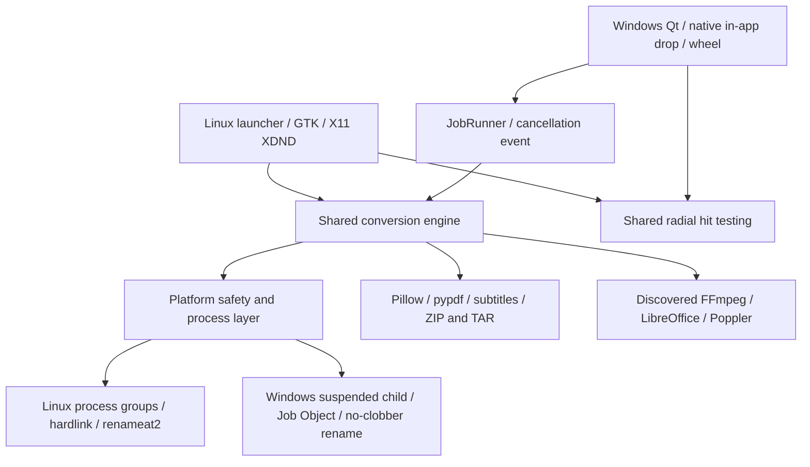

# Architecture and audit

## Audit of the existing application

The pre-port application contained Python entry/CLI `mandarin/__main__.py`,
GTK `ui.py`, X11 XDND `overlay.py`, a reusable conversion backend `engine.py`,
a per-user Linux installer and launch script. It had 12 backend tests and an
actual X11 drag harness. All 12 passed before changes, and the X11 conversion
wheel test passed. The original files were snapshotted locally before edits.
No Git history was present in the application folder; no history was discarded.

Pillow, pypdf, ZIP/TAR and subtitle logic were reusable. GTK/GI, X11 pointer
inspection, POSIX process groups, hard links and Linux renameat2 could not simply
be used on Windows. Existing private vendor FFmpeg binaries were Linux ELF
programs. The launcher assumed `/usr/bin/python3`; no Windows build existed.

GTK is retained on Linux, including its established X11 wheel and file actions.
For Windows, PySide6 Essentials provides a pip-distributed Qt runtime, native
file dialogs/drop support and a documented PyInstaller deployment path. Keeping
the frontend separate avoids introducing an entire Windows GTK/GI runtime into
the Linux packaging or rewriting the working Linux UI. Qt is dynamically bundled;
its LGPL/GPL/commercial terms remain separate from Mandarin's MIT license.
See [Qt licensing](https://doc.qt.io/qtforpython-6/licenses.html).

## Boundaries

- `engine.py`: format/operation discovery, validated options, batch processing,
  temporary work on the destination filesystem, real conversions, original
  preservation and partial output results. FFmpeg encoders and Pillow writers
  are inspected before advertising conversions. Suffix-based detection is a
  routing hint; converters validate actual content and errors are surfaced.
- `platform_support.py`: executable discovery/settings, portable archive names,
  no-overwrite publication and process cancellation. Windows creates a suspended
  converter, assigns it to a kill-on-close Job and resumes it through documented
  Win32 thread APIs. Linux uses a private process group. Native Windows behavior
  requires Windows tests; it was not inferred from Linux mocks.
- `jobs.py`: one batch per Qt window, background worker, cancellation event,
  callbacks forwarded to Qt signals. GTK retains its existing background worker.
- `qt_ui.py`: file/folder selection, drop URL validation, operation list/options,
  output destination, wheel, progress/cancel, status errors and session history.
  Worker signals reach the main event loop; no widget access from worker threads.
- `ui.py` / `overlay.py`: preserved Linux desktop integration; shared hit testing
  is imported without coupling GTK to Qt.
- `scripts/build_portable.py`: target-host guard, bundled runtime, licenses,
  real frozen GUI/image smoke, PE inspection and archive/checksum generation.

## Data flow and safety

Local selection → compatible available operations → options → worker → private
staging → conversion → atomic no-clobber publication → progress/history.
Collision names use a numeric suffix; originals are not overwritten. Each input
is committed separately; failures/cancellation keep earlier completed outputs.
Staging is cleaned by temporary-directory contexts. External programs receive
argument arrays with no shell. LibreOffice gets an isolated profile and macro
security setting. Windows tool configuration lives in LocalAppData; Linux uses
XDG config. No conversion data is uploaded and the app has no account/telemetry.

Archives reject traversal, absolute/drive/ADS paths, reserved Windows names,
links and special files; extraction has 10,000-entry / 2-GiB declared-byte limits
and bounded copies. Duplicate file entries fail exclusive creation; case-only
collisions also fail on case-insensitive filesystems. No extraction is published
until the whole archive succeeds. These controls do not sandbox vulnerabilities
in optional converters; run trusted tools and inputs with ordinary user rights.
Image conversions use the first frame; OCR, DRM bypass and arbitrary archive
formats are not provided. Engine jobs have cancellation but no automatic runtime
timeout. Availability reflects executables/encoders, not a guarantee that every
possible input or LibreOffice filter succeeds.
